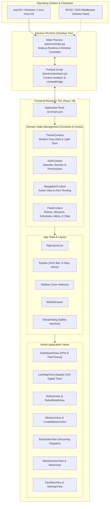
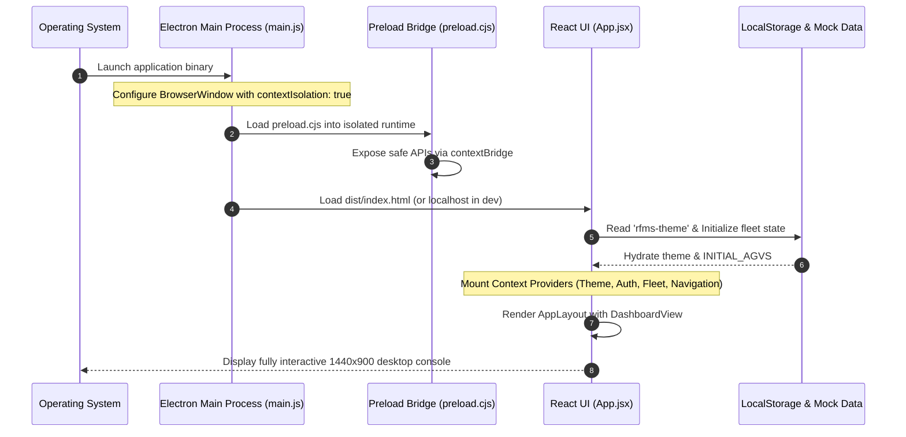
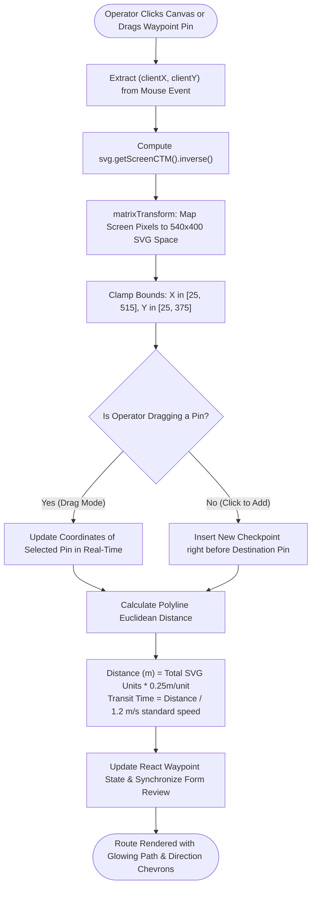
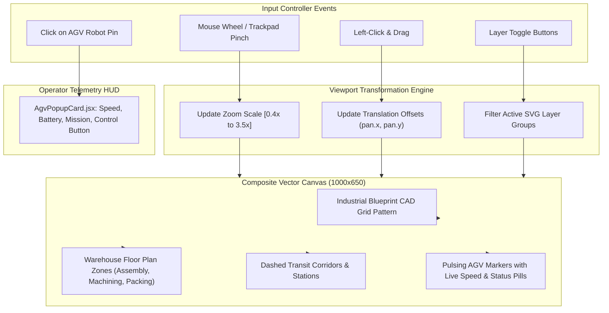
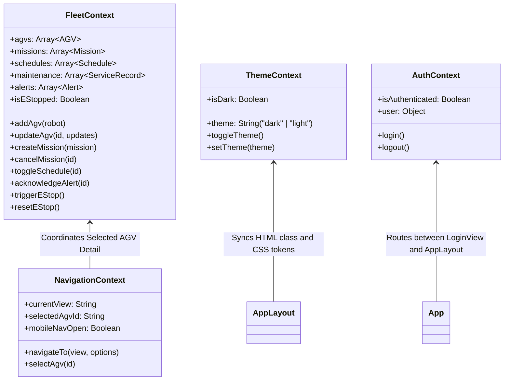

# 🤖 RFMS (Robotics Fleet Management System)
## Complete Software Architecture & System Flow Guide

---

## 1. Executive Overview

The **Robotics Fleet Management System (RFMS)** is an industrial-grade desktop application engineered for supervising, dispatching, and teleoperating autonomous mobile robots (AGVs / AMRs) inside modern factories and logistics warehouses.

The software is constructed on a **two-tier desktop architecture**:
1. **Host Native Runtime (Electron + Node.js)**: Governs the native operating system window, security interlocks, and low-level system integrations.
2. **Frontend Spatial Console (React 18 + Tailwind CSS + Radix UI)**: An industrial HUD interface providing digital-twin plant maps, drag-and-drop waypoint planning, telemetry streaming, and automated dispatching.

---

## 2. High-Level System Architecture

The following diagram illustrates how the complete software system is structured, from the native desktop runtime down to the domain component hierarchy:



---

## 3. Application Lifecycle & Startup Sequence

When the operator launches the application, Electron and Vite cooperate to boot the environment securely:



---

## 4. Waypoint Route Planner: Mathematical Flow

The **Waypoint Route Planner** ([`CreateMissionView.jsx`](file:///Users/shubham/Playground/RFMS/src/views/CreateMissionView.jsx)) lets operators click on the factory floor plan to plot robot navigation paths, drag existing checkpoints, and estimate travel time dynamically.

### Coordinate Projection Challenge & Solution
* **Screen Coordinates** (`clientX`, `clientY`): Depend on monitor size, zoom, DPI, and window dimensions.
* **SVG Floor Plan Space**: A fixed vector canvas with `viewBox="0 0 540 400"`.
* **The Solution**: Use the SVG's **Screen Current Transformation Matrix (CTM)** inverse to project mouse clicks into the exact canvas coordinate system:

$$\begin{pmatrix} X_{\text{svg}} \\ Y_{\text{svg}} \end{pmatrix} = \mathbf{CTM}^{-1} \begin{pmatrix} X_{\text{client}} \\ Y_{\text{client}} \end{pmatrix}$$



---

## 5. Emergency Stop (E-Stop) Interlock Architecture

Safety is paramount in autonomous robotics. RFMS implements a global **Emergency Stop (E-Stop)** protocol that instantly freezes the fleet:

```mermaid
sequenceDiagram
    autonumber
    participant Op as Fleet Operator
    participant TopNav as TopNav HUD
    participant Modal as EStopDialog
    participant Fleet as FleetContext Store
    participant Robots as Active AGV Units (18 Robots)

    Op->>TopNav: Clicks 'E-Stop' Button
    TopNav->>Modal: Open Confirmation Dialog (open=true)
    Op->>Modal: Confirms 'Engage Global E-Stop'
    Modal->>Fleet: triggerEStop() Action Dispatched
    Note over Fleet: isEStopped = true
    Fleet->>Robots: Broadcast freeze: status='Stopped', speed=0.0 m/s
    Note over Robots: Dynamic mechanical brakes engage; missions halt
    Fleet-->>TopNav: TopNav displays golden 'Resume Fleet' indicator
    Note over Op,Robots: System is completely frozen until explicit manual operator clearance
    Op->>TopNav: Clicks 'Resume Fleet'
    TopNav->>Fleet: resetEStop() Dispatched
    Fleet->>Robots: Clear interlocks & restore default fleet state
```

---

## 6. Live Map CAD Digital Twin Engine

The **Live Map** ([`LiveMapView.jsx`](file:///Users/shubham/Playground/RFMS/src/views/LiveMapView.jsx)) provides a spatial digital twin of the factory floor:



---

## 7. State Management & Data Architecture

To avoid monolithic code and prop drilling, the frontend uses a **Domain-Driven Context Architecture**:



---

## 8. Directory Structure & File Map

| Directory | Purpose | Key Files |
| :--- | :--- | :--- |
| `electron/` | Native desktop runtime | `main.js` (Window creation), `preload.cjs` (IPC bridge) |
| `src/context/` | Centralized business state | `FleetContext.jsx`, `NavigationContext.jsx`, `ThemeContext.jsx`, `AuthContext.jsx` |
| `src/hooks/` | Custom consumption hooks | `useFleet.js`, `useNavigation.js`, `useTheme.js`, `useAuth.js` |
| `src/constants/` | System configuration | `index.js` (`VIEWS`, `AGV_STATUS`, `MISSION_STATUS`, `ROUTE_PRESETS`) |
| `src/utils/` | Mathematics & formatting | `svg.js` (CTM projection, distance), `formatters.js` (Battery, speed) |
| `src/components/layout/` | Shell frame | `AppLayout.jsx`, `Sidebar.jsx`, `TopNav.jsx`, `MobileDrawer.jsx`, `EStopDialog.jsx` |
| `src/components/route-planner/` | Route planning domain | `WaypointRoutePlanner.jsx`, `FloorPlanZones.jsx`, `RouteTimeline.jsx` |
| `src/components/map/` | Spatial digital twin | `MapToolbar.jsx`, `AgvPopupCard.jsx`, `MapLegend.jsx` |
| `src/components/robots/` | AGV domain | `AddRobotModal.jsx`, `RobotModelIllustration.jsx` |
| `src/components/dashboard/` | Analytics domain | `FleetKpiCards.jsx`, `FleetStatusDonut.jsx` |
| `src/components/common/` | Reusable primitives | `StatusBadge.jsx`, `KpiCard.jsx`, `Card.jsx` |
| `src/views/` | 13 Dedicated application screens | `DashboardView.jsx`, `LiveMapView.jsx`, `RobotsView.jsx`, `CreateMissionView.jsx`, etc. |
| `src/App.jsx` | Declarative root | Composes providers and loads `AppLayout` |

---

## 9. Developer Quick Reference

### Running the Application in Development
```bash
npm run dev
```
Starts the Vite dev server and launches Electron with live hot-reloading.

### Building for Production
```bash
npm run build
```
Executes two sequential builds:
1. `vite build`: Compiles React 18, Tailwind CSS, and assets into `dist/`.
2. `vite build` (electron config): Bundles `electron/main.js` and `electron/preload.js` into `dist-electron/`.
